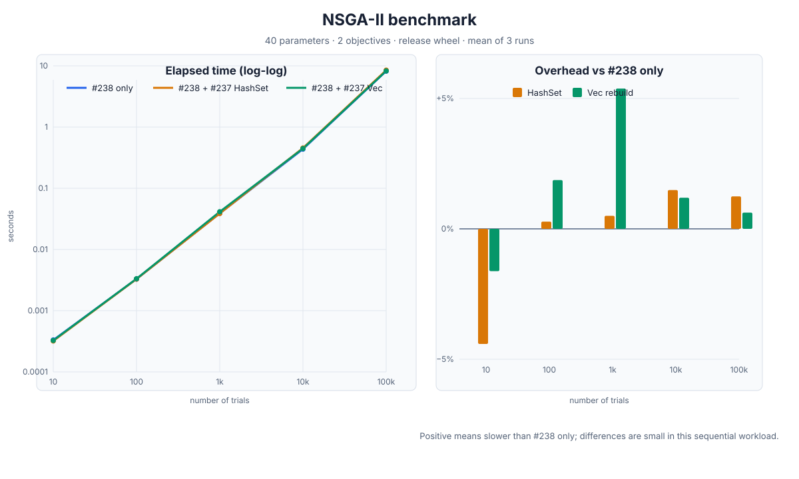

# NSGA-II benchmark report: PR #238 and #237 cache variants

## 結論

今回の単純な単一プロセス NSGA-II ベンチマークでは、`#238 only` が最速でした。
`#237` の generation cache を追加しても、#238 がすでに parent trial の直接 lookup を行うため、速度改善はありません。HashSet 版・Vec 再構築版ともに、#238 only よりおおむね 0–1.5% 遅くなりました。

この条件で選ぶなら、`Vec` 再構築版を推奨します。100,000 trials の平均は HashSet より約 0.6%（約 0.051 秒）速く、実装も「旧未完了リストを再確認し、新しい Vec に未完了 trial だけを append」する形で単純です。ただし、差は小さく、1,000 trials では Vec が HashSet より約 5.4% 遅いため、実用上は同等と見るべきです。

`#237` を組み合わせる価値は、今回の速度ではなく、他 worker が完了・更新した trial を generation cache に反映する正しさです。単一 worker だけなら #238 only が適切です。

## 比較対象

| 構成 | checkout / 固定 commit | 内容 |
|---|---|---|
| #238 only | `c75fbea` | persisted parent ID を `get_cached_trial` で解決 |
| #238 + #237 | `d87fc0d` | #238 に #237 の `GenerationIndexCache` と `unfinished_trial_numbers: HashSet<u32>` を追加 |
| #238 + #237 + Vec | `f919e76` | 上記 HashSet を、毎回新しい Vec に未完了 trial を append する方式へ変更 |

worktree は以下に作成しました。

- `/private/tmp/rustuna-pr238`
- `/private/tmp/rustuna-pr238-pr237`
- `/private/tmp/rustuna-pr238-pr237-vec`

組み合わせ版は #238 を基点に #237 を統合しています。Vec 版の `sync_generation_cache` は旧 Vec を `std::mem::take` で取り出し、再確認後の `Running`/`Waiting` trial と新規に見つかった未完了 trial を新しい Vec へ `push` します。

## ベンチマーク条件

- macOS arm64（Darwin 25.6.0）
- Python 3.11.16
- Rust release build（rustc 1.97.1 / cargo 1.97.0）
- `NSGAIISampler(seed=1)`、population size はデフォルトの 50
- `rustuna.create_study(..., directions=["minimize", "minimize"])`
- 各 trial で 40 個の `suggest_float("x0" ... "x39", 0.0, 1.0)`
- 目的値は次の 2 つ：`sum(x*x)` と `sum((x-1)**2)`
- InMemory storage、逐次実行
- 計測区間は `study.optimize` のみ。wheel 作成、インストール、import は除外
- 各試行数を 3 回計測し、表は平均値。試行数は `10 / 100 / 1,000 / 10,000 / 100,000`

## 結果

単位は秒です。括弧内は 3 回の最小値–最大値です。

| trials | #238 only | #238 + #237 HashSet | #238 + #237 Vec |
|---:|---:|---:|---:|
| 10 | 0.000327 (0.000242–0.000442) | 0.000313 (0.000240–0.000449) | 0.000322 (0.000257–0.000410) |
| 100 | 0.003264 (0.003076–0.003397) | 0.003273 (0.003201–0.003390) | 0.003325 (0.003252–0.003439) |
| 1,000 | 0.038701 (0.038192–0.039581) | 0.038895 (0.038151–0.040211) | 0.040784 (0.040483–0.041090) |
| 10,000 | 0.435640 (0.432390–0.439603) | 0.442112 (0.439314–0.447528) | 0.440841 (0.437525–0.445544) |
| 100,000 | 8.214977 (8.185507–8.250729) | 8.317212 (8.270603–8.356713) | 8.266140 (8.085121–8.372326) |

### #238 only に対する差

| trials | HashSet | Vec rebuild |
|---:|---:|---:|
| 10 | −4.42% | −1.62% |
| 100 | +0.28% | +1.87% |
| 1,000 | +0.50% | +5.38% |
| 10,000 | +1.49% | +1.19% |
| 100,000 | +1.24%（+0.102秒） | +0.62%（+0.051秒） |

10 trials の負の差は計測時間が 0.3 ms 程度であることによるノイズです。大きな trial 数では、Vec と HashSet の差は数十 ms 程度です。

## 正しさの確認

ベンチマークが空回りしていないことを、以下で確認しました。

1. 各 run 後に `len(study.get_trials()) == n_trials` を検査。
2. 全 trial が `TrialState.COMPLETE` であることを検査。
3. 全 trial が 40 パラメータを持つことを検査。
4. 全 trial が 2 個の objective value を持つことを検査。
5. 各構成を別々の release wheel としてビルドし、インストール後の `rustuna._rustuna` のパスを確認。
6. `rustuna_sampler` の unit test と doctest を実行。

| 構成 | unit test | doctest |
|---|---:|---:|
| #238 only | 23 passed | 2 passed |
| #238 + #237 HashSet | 27 passed | 2 passed |
| #238 + #237 Vec | 27 passed | 2 passed |

## ボトルネックと解釈

PR #237 単体では、parent cache を復元するために各 `sample_joint` で全 trial を走査して `trial_id -> trial_number` の HashMap を作っていました。このため trial 数が大きいと累積コストが O(N²) になります。

PR #238 はこの処理を `get_cached_trial(trial_id)` に置き換え、storage 内の ID index を直接使います。今回の結果でも 100,000 trials が約 8.2 秒に収まり、#237 単体で見られた 100 秒超の増加はありません。

一方、#238 + #237 ではこの全 trial scan は残っていません。そのため `unfinished_trial_numbers` の Set/Vec は主ボトルネックにならず、#237 の追加コスト（cache sync、lock、未完了 trial の再確認）がわずかに見えるだけです。今回の逐次実行では未完了 trial の数がほぼ 1 なので、Set の O(1) lookup の優位性も現れません。

なお、このベンチは multi-worker の競合を測っていません。複数 worker が同時に Running/Waiting trial を持つケースでは、`#237` の cache 同期による正しさを別途確認する必要があります。

